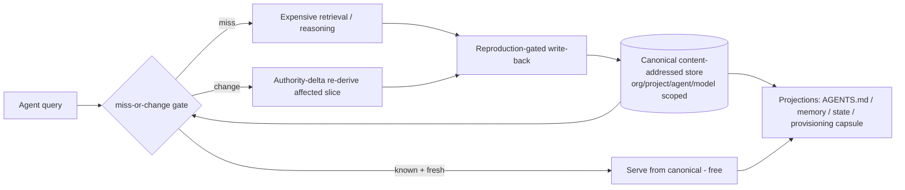

# Design: the unified knowledge substrate

The spine that ties four apparently-separate problems into one primitive:
compaction loss, hand-synced duplication, agent provisioning, and fleet
economics. They are the same problem viewed from four angles. Solve the substrate
once and all four collapse.

## Thesis

There is **one content-addressed, scope-tagged canonical knowledge store**. Every
fact — an org policy, a project decision, an agent's calibration, a model's
KnowledgeProfile, a retrieved document, a proven absence — is stored **once**,
addressed by identity, and tagged with the scope(s) it belongs to. Everything
that today looks like a separate artifact — `AGENTS.md`, `CLAUDE.md` context, the
memory index, `STATE.md`, todos, a provisioning capsule — is a **projection** of
that store, generated and pinned to its load point, never hand-authored twice.

Two behaviors ride on top:

- **A miss-or-change gate** in front of all compute: known-and-fresh facts are
  served for free; expensive retrieval or reasoning fires *only* on a genuine
  miss or a detected change.
- **A reproduction-gated write-back path**: work done once is proposed back into
  the canonical store, so it is a hit forever after — for every agent, not just
  the one that did it.

The store is the RAG registry we already run. The gate and the write-back are
what turn "agents that can look things up" into "a fleet that never solves the
same problem twice."

## Scopes and what is canonical at each

The identity/occurrence split (store identical bytes once, keep occurrences as
scoped references) applies across four dimensions, not one:

| Scope | Canonical facts held once, referenced everywhere |
| --- | --- |
| **Org** | goals, budgets, policies, roles + reports_to chain, approval envelopes, playbooks, brand/voice, customers, revenue state, learned outcomes (what worked / failed) |
| **Project** | objective, decisions/ADRs, todos/backlog, blockers, checkpoints, conventions (the `AGENTS.md`/`CLAUDE.md` content), evidence corpus |
| **Agent** (role) | role prompt, adapter config, skills, tool bundle, capability envelope, Hindsight memory, calibration, provisioned capsule |
| **Model** | base + license + temporal cutoff, KnowledgeProfile, eval set, competency envelope, learned residuals/adapters, the optimized prompt per model×role |
| **Cross-cutting** | success contracts, run logs, decision receipts, demo/trace banks, tool + discovery catalogs, and **proven absences** (negative results) |

A fact shared across scopes (an org policy that also governs a project) is stored
once and referenced from both. No scope owns a private copy; each owns a scoped
*binding* to the canonical payload.

## Projections, not copies

`AGENTS.md` at a path, the session-loaded `CLAUDE.md` block, the memory index, a
task's state file — each **must** physically exist at a specific location for a
specific loader. That does not justify authoring them by hand N times. Each is a
**generated projection** pinned to its load point. Edit the canonical fact once;
the authority-delta loop invalidates and regenerates only the affected
projections. The repo's "keep docs in sync on every commit" tax — an O(N)
hand-fan-out with guaranteed drift — goes to zero, because there is one source
and the copies are derived.

The three "capsules" we have been circling are just three projection shapes over
the same store:

- **Provisioning capsule** — a task-scoped *lineage-subset* + preconnected tool
  bundle, handed to an agent at spin-up.
- **State capsule** — the durable `{objective, decisions, todos, blockers,
  checkpoints, evidence-pointers}` for a task/project, reloaded on session start.
- **Memory** — the cross-session recall view.

Because the state capsule is durable and addressable, **compaction stops being a
risk**: it drops the transcript (recoverable narrative), never the structured
state. The goal is not to preserve the conversation — it is to make the capsule
complete enough that losing the conversation costs nothing.

## The miss-or-change gate

Every query passes four checks *before* spending a FLOP:

1. **Known?** canonical-store hit → serve, zero new compute.
2. **Still valid?** the TEF/TEC validity horizon says fresh → serve; expired
   counts as a change.
3. **Already proven absent?** the negative-results cache → do not re-run a search
   we already showed returns nothing.
4. **Cheapest sufficient path?** MSEP orders the routes: rule → cache →
   retrieval → small model → specialist → large model, and stops at the first
   that satisfies the Success Contract.

Outcomes:

- **Hit + fresh** → free.
- **Miss** → do the expensive work once, then write it back canonically; next
  time it is a hit.
- **Change** → the authority-delta loop + content-addressed impact manifest
  invalidate only the affected slice and re-derive that, preserving historical
  generations.

The default is "known, do not spend." The gate only *opens* to expensive work on
a real miss or a real delta. Compute is therefore spent solely on the **novelty +
delta frontier**.

## The write-back path (the load-bearing half)

A read-only gate over a static store just gives every agent a nice cache. The
compounding comes from **closing the write path**: an agent's run ends by
proposing structured findings — a resolved fact, a new procedure, a proven
absence, a calibration update — into a registry proposal channel, admitted only
after independent reproduction/verification (never self-authorized, never
model-prose-as-truth). Then work done once by one agent becomes canonical for
all.

This is not speculative: the measured version is **AgentRxiv** — a shared,
searchable artifact store turned N isolated agent runs into +13.7% compounding
progress. Without the write-back, a fleet is N re-derivers sharing a read cache;
with it, the fleet compounds.

## Reusable generative artifacts (templates, snippets, texts)

The gate so far stops re-*retrieval* of known facts. A second, symmetric waste is
re-*generation* of known outputs: over days on one topic, overlapping requests
make an agent produce the same scaffold, config, snippet, prompt or boilerplate
text again and again. The fix is the same primitive with one added property —
**parameterization**.

A reusable artifact is a distinct class in the canonical store: content-addressed,
versioned and scope-tagged like everything else, but stored as a **producer** —
typed slots plus a *fit-condition* (when does this template apply?) — not a frozen
copy. This is the identity/occurrence split extended to generation: store the
canonical generative *form* once, never N concrete outputs of it.

The gate then applies to generation, not just retrieval:

- **Fit-match a template** → instantiate: fill the slots, near-free. The second
  and later similar requests in a multi-day session are instantiations, not
  regenerations.
- **Genuinely novel** → generate once, then — via the same write-back path —
  propose it back as a template: a small specialist generalizes the concrete
  instance into a slotted form + fit-condition, reproduction/quality-gated before
  admission. Exactly the loop that auto-creates skills and hooks, applied to
  snippets, configs, prompts and texts.

Archeion already has the seed: the `scaffold-*` / `add-*` skills are hand-authored
templates. This makes them a first-class versioned artifact class, auto-grows the
library from novel outputs, and generalizes it beyond code to config, prompt,
report and prose. And it is more headroom: regenerating boilerplate is pure
waste; instantiation is the novelty + delta frontier applied to *outputs*.

## Fleet economics — why this is Paperclip done right

A fleet is expensive today because N agents/orgs each re-derive, re-search and
re-reason in isolation and burn budget repeating one another. Put the canonical
store + gate + write-back underneath them and total fleet compute collapses to
the novelty + delta frontier: nobody pays to rediscover what the fleet already
knows and that is still fresh. The memory-unification is therefore not a side
quest beneath the RAG — it is the mechanism that makes the fleet *economical*.

## Easy 80% vs hard 20%

- **Substrate — exists.** Content-addressing, dedup, signed multidomain
  retrieval, and a partial write-back (the harvest → ingest loop) are already
  built. This is the registry.
- **The gate — the build.** Freshness/validity horizons and change detection,
  the negative-results cache, and the MSEP router are design in the CordanaAI doc
  (§2, §3, §5, §11) but not yet an automatic runtime.
- **Auto-consolidation — the hard 20%.** The sleep/QC loop that dedupes, merges
  refinements, decays stale entries and prunes without losing lineage (§6, §8,
  §11). A dumb "one canonical fact, referenced everywhere, regenerate on delta"
  version captures most of the value first.

**Cheapest first proof:** make the registry canonical for *one* project's
meta-knowledge, generate one projection from it (e.g. a module `AGENTS.md`), and
show that editing the canonical fact regenerates the projection with no hand-sync
— then wire the miss-or-change gate over that one project's queries and measure
the compute that never fires.

## Relationship to the CordanaAI preview

This is a focused deepening of the CordanaAI architecture, not a replacement. It
composes existing pieces — the identity/occurrence split and authority-delta loop
(§3), TEF/TEC freshness (§2), MSEP (§5), the Temporal Evidence Stream and memory
consolidation (§6), and first-class negative results (§11) — into a single
operational spine: **one scoped canonical store, everything else a projection,
compute only on miss-or-change, and a reproduction-gated write-back that makes the
fleet compound.**
